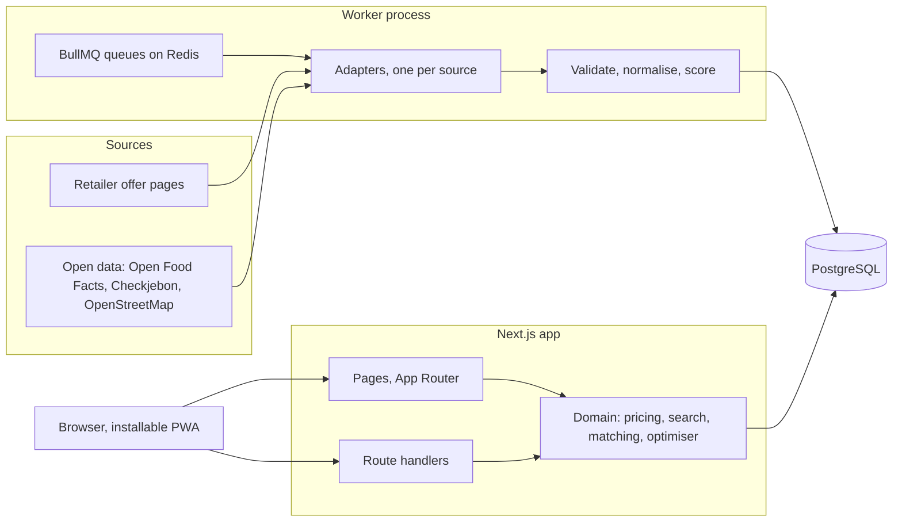

# Architecture

One Next.js application plus one worker process, sharing a PostgreSQL database. Decisions behind this shape are in `docs/decisions.md`.

## Layout

| Path | Holds | May import |
|---|---|---|
| `src/domain/pricing` | Money, units, validity dates, promotion mechanics. Pure functions. | nothing outside `src/domain` |
| `src/domain/offers` | What the interface derives from a stored offer: state today, labelled estimates, URL filters. Pure functions. | `src/domain` |
| `src/domain/search` | Name normalisation, query parsing (size, barcode, brand, category, flags), Dutch/Italian/English synonyms, fuzzy-match thresholds, lowest-price marks. Pure functions. | `src/domain` |
| `src/domain/matching` | Product matching and classification. Pure functions. | `src/domain` |
| `src/domain/optimizer` | Basket optimisation: pricing a line, choosing 1 to 3 chains, reason codes, the plan settings read from the address and the notes behind "why this route?". Pure functions. | `src/domain` |
| `src/ingestion` | Adapter contract, HTTP client, robots check, validation, runner, adapters; `match-products.ts` rebuilds the links between the chains' listings after a run. | `src/domain`, `src/lib` |
| `src/worker` | BullMQ entry point and schedules. | `src/ingestion`, `src/lib` |
| `src/lib` | Database client and other shared infrastructure. | `src/generated` |
| `src/server` | Database queries used by pages and route handlers; the Server Functions behind forms (`list-actions.ts`, `feedback-actions.ts`), each validating its own input; the device cookie. `catalog.ts` prices a listing today; `search.ts`, `comparison.ts` and `plan.ts` (the route for the device's list) build on it. `admin.ts`, `admin-actions.ts`, `admin-auth.ts` and `admin-session.ts` are the admin panel (below). | `src/domain`, `src/lib` |
| `src/app` | Pages, layouts, route handlers; `/more/sources` is the in-app "data sources and accuracy" page, fed by `src/server/sources.ts`. | everything above except `src/worker` |
| `src/components` | React components: `shell` (layout, navigation), `ui` (primitives from `DESIGN.md`), `offers`, `products`, `list`, `plan`, `settings`, `admin`. | `src/domain` types, `src/i18n`, `src/lib` |
| `src/i18n`, `messages/` | Routing, request config, translations. | — |
| `prisma/` | Schema, migrations, seed. | — |
| `tests/integration` | Tests that need the database. | — |
| `tests/e2e` | Playwright tests against a production build. | — |

`src/domain` never touches the database, the network, the clock or environment variables: anything it needs is passed in. That is what keeps it unit-testable and lets the worker and the web app share it.

## Admin panel

`/admin` (chains, latest runs, price reports, categories) and `/admin/matches` (links between listings that wait for a decision). It is for the one person who runs the app.

- **Off by default.** With `ADMIN_TOKEN` empty or shorter than 32 characters the pages answer 404 and every admin Server Function refuses.
- **Sign-in.** The token is exchanged for a cookie (`ss_admin`: HttpOnly, SameSite=Strict, 8 hours) holding an expiry and an HMAC made with the token. Nothing is stored on the server; changing the token ends every session. There is no lockout after wrong tokens: it would let anyone keep the owner out, and a random token of that length cannot be guessed. Known limits: signing out removes the cookie from the browser but a copy of it stays valid until it expires (change the token to end it), and the cookie is marked Secure only when the proxy in front sends `X-Forwarded-Proto: https`.
- **Every page and every action checks the session itself.** `AdminGate` renders only the sign-in form without one and does not run the admin queries; the Server Functions are public POST endpoints and each starts with `isAdmin()`.
- **Chains.** Two switches per chain: `active` (shown in the app) and `adapterEnabled` (the real adapter may run). The runner reads `adapterEnabled` when a run starts, so a change applies from the next run. `INGESTION_ENABLED_ADAPTERS` stays the second switch and can only be changed in the environment.
- **Links.** The queue holds links with status `NEEDS_REVIEW` and links a visitor reported. A decision sets `CONFIRMED` with the chosen type, or `REJECTED`; the matcher never changes a decided link (see `data-model.md`).

## Conventions

- **Money** is an integer number of euro cents (`priceCents`). No floating-point euros anywhere, including the database.
- **Quantities** are stored in base units: grams, millilitres or pieces, with the unit kind alongside.
- **Validity** of an offer is a pair of calendar dates in the Europe/Amsterdam time zone, both inclusive. Promotion weeks differ per retailer, so validity is always per offer.
- **Unknown stays unknown.** A parser that cannot read a value returns an explicit "not recognised" result; it never guesses a number. An offer without a known validity is stored with status `unverified` and labelled as such in the interface.
- **Demo data** carries `isDemo = true` and the interface labels it "Demodata".
- **Provenance**: every offer keeps its source URL, collection time, content hash, a minimised raw payload and a parsing confidence between 0 and 1.
- **Tests**: unit tests sit next to the code as `*.test.ts`; database tests live in `tests/integration` and run against `TEST_DATABASE_URL` only. No test makes a real network request.
- **Interface text** always goes through `next-intl` messages in `messages/{nl,en,it}.json`; no hard-coded strings in components.
- **Next.js 16**: read the relevant guide under `node_modules/next/dist/docs/` before using an API; conventions changed (for example `src/proxy.ts` replaces `middleware.ts`). Cache Components are off: pages render dynamically.
- **Prisma 7**: the client is generated into `src/generated/prisma` (not committed) and created with the `@prisma/adapter-pg` driver adapter in `src/lib/db.ts`. Configuration is in `prisma.config.ts`.

## Commands

| Command | Does |
|---|---|
| `docker compose up -d` | starts PostgreSQL and Redis |
| `npm run dev` | app on http://localhost:3000 |
| `npm run worker` | ingestion worker (needs Redis) |
| `npm run ingest -- <adapter-id\|all>` | one collection run without Redis |
| `npm run db:migrate` | creates and applies a migration on the development database |
| `npm run db:test:deploy` | applies migrations to the test database |
| `npm run db:seed` | seeds retailers, categories and labelled demo data |
| `npm run verify` | lint, typecheck, unit tests, integration tests |
| `npm run test:e2e` | builds the app and runs Playwright against it |
