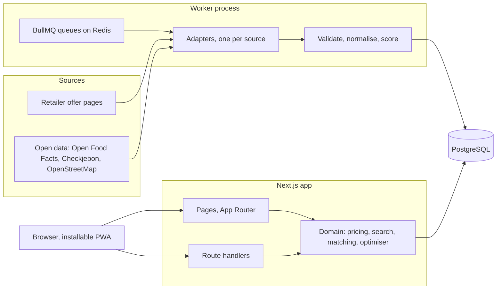

# Architecture

One Next.js application plus one worker process, sharing a PostgreSQL database. Decisions behind this shape are in `docs/decisions.md`.

## Layout

| Path | Holds | May import |
|---|---|---|
| `src/domain/pricing` | Money, units, validity dates, promotion mechanics. Pure functions. | nothing outside `src/domain` |
| `src/domain/offers` | What the interface derives from a stored offer: state today, labelled estimates, URL filters. Pure functions. | `src/domain` |
| `src/domain/search` | Query parsing and synonyms. Pure functions. | `src/domain` |
| `src/domain/matching` | Product matching and classification. Pure functions. | `src/domain` |
| `src/domain/optimizer` | Basket optimisation. Pure functions. | `src/domain` |
| `src/ingestion` | Adapter contract, HTTP client, robots check, validation, runner, adapters. | `src/domain`, `src/lib` |
| `src/worker` | BullMQ entry point and schedules. | `src/ingestion`, `src/lib` |
| `src/lib` | Database client and other shared infrastructure. | `src/generated` |
| `src/server` | Database queries used by pages and route handlers. | `src/domain`, `src/lib` |
| `src/app` | Pages, layouts, route handlers. | everything above except `src/worker` |
| `src/components` | React components: `shell` (layout, navigation), `ui` (primitives from `DESIGN.md`), `settings`. | `src/domain` types, `src/i18n`, `src/lib` |
| `src/i18n`, `messages/` | Routing, request config, translations. | — |
| `prisma/` | Schema, migrations, seed. | — |
| `tests/integration` | Tests that need the database. | — |
| `tests/e2e` | Playwright tests against a production build. | — |

`src/domain` never touches the database, the network, the clock or environment variables: anything it needs is passed in. That is what keeps it unit-testable and lets the worker and the web app share it.

## Conventions

- **Money** is an integer number of euro cents (`priceCents`). No floating-point euros anywhere, including the database.
- **Quantities** are stored in base units: grams, millilitres or pieces, with the unit kind alongside.
- **Validity** of an offer is a pair of calendar dates in the Europe/Amsterdam time zone, both inclusive. Promotion weeks differ per retailer, so validity is always per offer.
- **Unknown stays unknown.** A parser that cannot read a value returns an explicit "not recognised" result; it never guesses a number. An offer without a known validity is stored with status `unverified` and labelled as such in the interface.
- **Demo data** carries `isDemo = true` and the interface labels it "Demodata".
- **Provenance**: every offer keeps its source URL, collection time, content hash, a minimised raw payload and a parsing confidence between 0 and 1.
- **Tests**: unit tests sit next to the code as `*.test.ts`; database tests live in `tests/integration` and run against `TEST_DATABASE_URL` only. No test makes a real network request.
- **Interface text** always goes through `next-intl` messages in `messages/{nl,en,it}.json`; no hard-coded strings in components.
- **Next.js 16**: read the relevant guide under `node_modules/next/dist/docs/` before using an API; conventions changed (for example `src/proxy.ts` replaces `middleware.ts`). Cache Components are off: pages render dynamically.
- **Prisma 7**: the client is generated into `src/generated/prisma` (not committed) and created with the `@prisma/adapter-pg` driver adapter in `src/lib/db.ts`. Configuration is in `prisma.config.ts`.

## Commands

| Command | Does |
|---|---|
| `docker compose up -d` | starts PostgreSQL and Redis |
| `npm run dev` | app on http://localhost:3000 |
| `npm run worker` | ingestion worker |
| `npm run db:migrate` | creates and applies a migration on the development database |
| `npm run db:test:deploy` | applies migrations to the test database |
| `npm run db:seed` | seeds retailers, categories and labelled demo data |
| `npm run verify` | lint, typecheck, unit tests, integration tests |
| `npm run test:e2e` | builds the app and runs Playwright against it |
