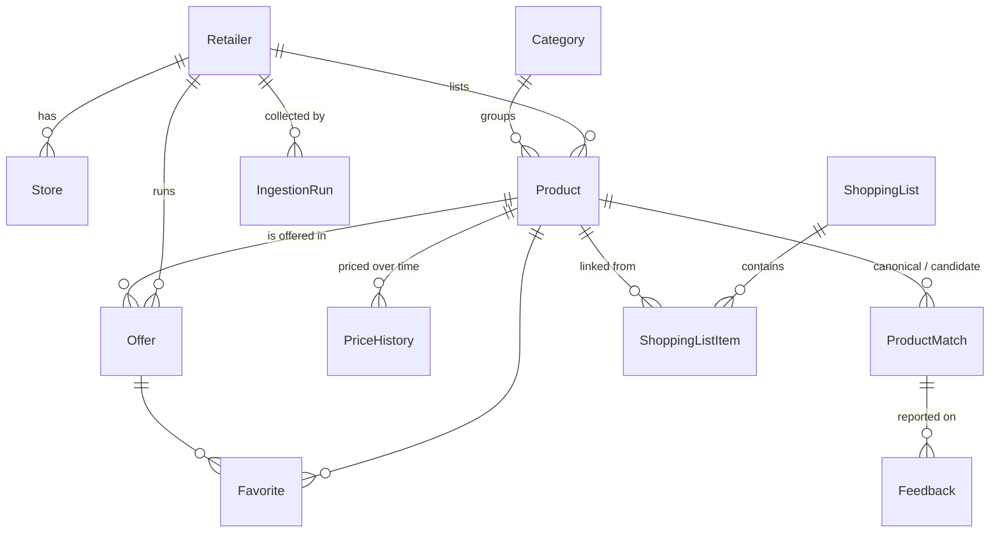

# Data model

Source of truth: `prisma/schema.prisma` and `prisma/migrations/`. This page explains the choices the schema alone does not.

## Rules

| Rule | Where it is enforced |
|---|---|
| Money is integer euro cents | every `*Cents` column is `Int`; negative values are refused by check constraints |
| An unknown value is `NULL`, never a guessed number | nullable price, unit and validity columns |
| Validity is a pair of inclusive calendar dates in Europe/Amsterdam | `validFrom` / `validUntil` are PostgreSQL `date` columns; `src/lib/dates.ts` converts |
| An offer without a known end date is never shown as verified | check `offers_verified_needs_validity`: `status = VERIFIED` requires `validUntil` |
| Every offer keeps its provenance | `sourceUrl`, `collectedAt`, `contentHash`, `rawPayload`, `confidence` are required columns |
| Re-collecting the same offer updates it instead of duplicating it | unique `(retailerId, contentHash)` on offers, unique `(retailerId, externalId)` on products |
| Demo rows are recognisable | `isDemo` on products, offers and price history; the interface labels them "Demodata" |

## Choices

- **A product row is one source's listing.** The same real-world product at two chains is two rows, linked by `ProductMatch` (`SAME`, `SIMILAR`, `ALTERNATIVE`) with a confidence and a review status. Nothing is merged destructively, so a wrong match can be rejected without losing data.
- **Regular prices live in `PriceHistory`**, promotions in `Offer`. The price of a product today is its running offer if there is one, otherwise the latest price-history record.
- **Promotion mechanics** are `promoType` plus `promoParams`, shaped like the `Promotion` union in `src/domain/pricing` (`{ buy, free }`, `{ n }`, `{ quantity, totalCents }`, `{ percent }`). `promoDescription` keeps the chain's own wording.
- **`Offer.kind`** separates the weekly cycle from one-day deals (Vomar Dagknallers).
- **`Retailer.adapterEnabled`** is the per-chain kill switch for the real adapter and is off by default.
- **Lists and favourites carry a `deviceId`**, a random identifier, not an account: the MVP has no sign-in. The id is a random UUID kept in the `ss_device` cookie (`src/server/device.ts`): HttpOnly, SameSite=Lax, one year, written the first time something is saved and never on a page view. Every function in `src/server/lists.ts` takes the device id and filters on it, so another device's id behaves like one that does not exist. The current list is the one used last (`updatedAt`); a device holds at most 20 lists of 100 items. A list item keeps its `label` and, when it was added from a result or an offer, the `productId` of that chain's listing; `pinnedRetailerId` is "always buy this here". "Delete my data" on the More page removes the lists and favourites of the device and the cookie. Not built yet: removing the lists of devices that never come back.
- **Search** (`src/server/search.ts`) matches every word of the query against `products.normalizedName`, the output of `normalizeName` (`src/domain/search`): as a substring, as a Dutch word stem (PostgreSQL full-text) or, for words of four letters or more, by trigram word similarity (`pg_trgm`), which is what forgives typos. A GIN trigram index covers the substring match; the similarity and full-text conditions are evaluated per row, which is fine for an offers-only catalogue and the first thing to index if it grows.
- **Links between listings are rebuilt, not edited by hand.** `rebuildMatches` (`src/ingestion/match-products.ts`) compares every pair of listings from two different active chains with `matchProducts` (`src/domain/matching`) and writes one `ProductMatch` per linked pair, the lower id as `canonicalProductId`. It runs after the seed, after `npm run ingest` and after every worker run that stored something. A pair scoring 0.70 or more is `AUTO`; between 0.45 and 0.70 it is `NEEDS_REVIEW`; below that nothing is stored. Equal barcodes are `SAME` with confidence 1; without a barcode, `SAME` needs the same brand and size, `SIMILAR` the same size, and `ALTERNATIVE` is another size or variant compared per kg, litre or piece. A rebuild creates, updates and removes automatic rows only: a `CONFIRMED` or `REJECTED` link is a person's decision and is never overwritten.
- **Comparison shows decided links only.** `compareProduct` (`src/server/comparison.ts`) reads `AUTO` and `CONFIRMED` links; `NEEDS_REVIEW` and `REJECTED` never reach the interface. The lowest-price mark is decided among the product and its `SAME`/`SIMILAR` links; alternatives only compete on unit price.
- **Feedback** is a row with a `kind` (`WRONG_MATCH`, `WRONG_PRICE`), the link or the product it is about and, if the device already has one, its id. No free text is collected. A link or product keeps at most one open report (`resolvedAt` null): reporting again does nothing. Reporting never creates the device cookie.
- **Today's price of a product** is computed in one place, `loadProducts` (`src/server/catalog.ts`), through the optimiser's `priceCandidate`: search, comparison and the basket plan therefore always agree. An unverified offer never lowers it.

## Seed

`npm run db:seed` writes the four chains, the category tree and a demo catalogue (`prisma/seed/`). It is idempotent. Demo names, brands, prices and barcodes are invented; barcodes use the GS1 in-store prefix 20, which is never assigned to a real product. Demo offers are not written directly: the four mock adapters produce them through the ingestion pipeline (`docs/ingestion.md`), so the seed exercises the same validation and storage as a real run. Demo validity is counted from the day the seed runs, so the demo always has running, ending-today, upcoming and unverified offers; an expired offer is never stored, because validation rejects it. `SEED_DEMO=false npm run db:seed` writes reference data only.
