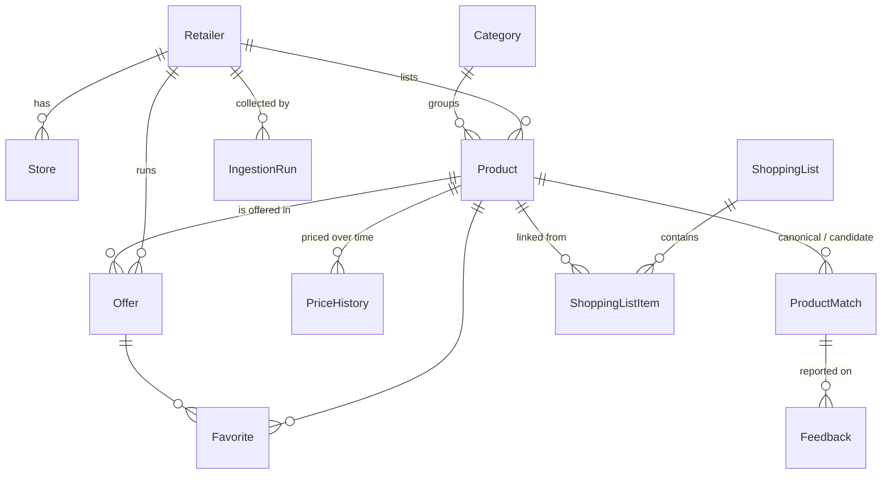

# Data model

Source of truth: `prisma/schema.prisma` and `prisma/migrations/`. This page explains the choices the schema alone does not.

## Rules

| Rule | Where it is enforced |
|---|---|
| Money is integer euro cents | every `*Cents` column is `Int`; negative values are refused by check constraints |
| An unknown value is `NULL`, never a guessed number | nullable price, unit and validity columns |
| Validity is a pair of inclusive calendar dates in Europe/Amsterdam | `validFrom` / `validUntil` are PostgreSQL `date` columns; `src/lib/dates.ts` converts |
| An offer without a known end date is never shown as verified | check `offers_verified_needs_validity`: `status = VERIFIED` requires `validUntil` |
| Every offer keeps its provenance | `sourceUrl`, `collectedAt`, `contentHash`, `rawPayload`, `confidence` are required columns |
| Re-collecting the same offer updates it instead of duplicating it | unique `(retailerId, contentHash)` on offers, unique `(retailerId, externalId)` on products |
| Demo rows are recognisable | `isDemo` on products, offers and price history; the interface labels them "Demodata" |

## Choices

- **A product row is one source's listing.** The same real-world product at two chains is two rows, linked by `ProductMatch` (`SAME`, `SIMILAR`, `ALTERNATIVE`) with a confidence and a review status. Nothing is merged destructively, so a wrong match can be rejected without losing data.
- **Regular prices live in `PriceHistory`**, promotions in `Offer`. The price of a product today is its running offer if there is one, otherwise the latest price-history record.
- **Promotion mechanics** are `promoType` plus `promoParams`, shaped like the `Promotion` union in `src/domain/pricing` (`{ buy, free }`, `{ n }`, `{ quantity, totalCents }`, `{ percent }`). `promoDescription` keeps the chain's own wording.
- **`Offer.kind`** separates the weekly cycle from one-day deals (Vomar Dagknallers).
- **`Retailer.adapterEnabled`** is the per-chain kill switch for the real adapter and is off by default.
- **Lists and favourites carry a `deviceId`**, a random identifier, not an account: the MVP has no sign-in.
- **Search** uses `pg_trgm`: a GIN trigram index on `products.normalizedName`, which holds the output of `normalizeName` (`src/domain/search`).

## Seed

`npm run db:seed` writes the four chains, the category tree and a demo catalogue (`prisma/seed/`). It is idempotent. Demo names, brands, prices and barcodes are invented; barcodes use the GS1 in-store prefix 20, which is never assigned to a real product. Demo validity is counted from the day the seed runs, so the demo always has running, ending-today, upcoming, expired and unverified offers. `SEED_DEMO=false npm run db:seed` writes reference data only.
