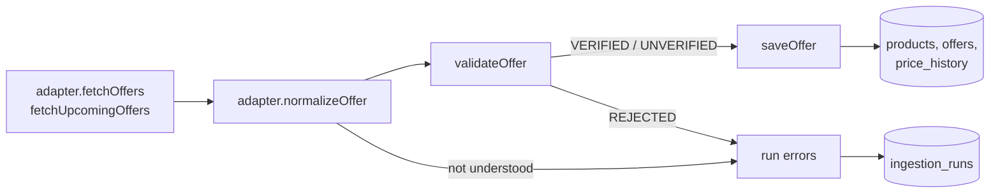

# Ingestion

How offers get from a chain's offer page into the database. The rules every adapter is bound by are in `docs/decisions.md` section 3; this file says where each one is enforced.

## Pipeline

One run of one adapter is one `ingestion_runs` row: status, items found, items stored, and a capped list of errors with the source URL and the minimised raw item. A failure in one item never stops the others, and a failure in one adapter never stops the next.

| Step | File | What it guarantees |
|---|---|---|
| Contract | `src/ingestion/adapter.ts` | Adapters read offer pages only; there is no catalogue method. |
| HTTP | `src/ingestion/http.ts` | GET only, no cookies or credentials, identifiable User-Agent, robots.txt read again on every run, 2 s between requests per host, timeout, retry with backoff, `Retry-After` honoured. Redirects are followed by hand so each hop passes the robots.txt check. An unreadable robots.txt blocks the host. |
| robots.txt | `src/ingestion/robots.ts` | RFC 9309 matching: most specific user-agent group, longest rule wins, Allow wins a tie. |
| Normalise | each adapter | Text to money, quantity, validity and mechanic through `src/domain/pricing`. A value that cannot be read stays unknown; it is never guessed. |
| Validate | `src/ingestion/validate.ts` | Rejects empty names, prices outside 0 to 1000 euros and expired offers. Unknown or approximate validity, an unknown mechanic or a regular price below the offer price make the offer UNVERIFIED ("to be verified" in the interface). |
| Store | `src/ingestion/store.ts` | Idempotent upserts on (chain, external id) and (chain, content hash). No image is stored. The regular price is added to the history only when it changed. |
| Run | `src/ingestion/runner.ts` | Kill switches, the daily limit, the run record. |

## Kill switches

A real adapter runs only when both are on; either one off records a SKIPPED run without a single request.

1. Its id is listed in `INGESTION_ENABLED_ADAPTERS` (empty by default).
2. `retailers.adapterEnabled` is true for its chain (false by default).

A takedown request means removing the id from the variable, the same day.

## Daily limit

A real adapter starts at most `maxRunsPerDay` runs per Europe/Amsterdam day (1 unless the adapter says otherwise); a further run is recorded as SKIPPED. The worker schedules one run per adapter per day from 05:15, ten minutes apart.

## Mock adapters

`mock:ah`, `mock:jumbo`, `mock:vomar` and `mock:dirk` (`src/ingestion/adapters/mock`) make no requests. They render the demo catalogue as the text a chain would print ("2e halve prijs", "t/m zondag") and send it through the same pipeline, so the parsers and the validation are exercised by the seed. Every row they write carries `isDemo`.

## Real adapters

Off by default. Each one runs only with its id in `INGESTION_ENABLED_ADAPTERS` and the chain's "Echte adapter" switch on in `/admin`. No live run has been made from the development container (retailer hosts are not reachable there): the parsers are tested against reduced copies of the real pages in `src/ingestion/adapters/<chain>/fixtures/`, captured once, without images. **Check the first live run by hand** (`npm run ingest -- <id>`, then the run and its errors in `/admin`).

A real adapter writes next to that chain's demo rows; it does not replace them. Rows from a real adapter are not marked `isDemo`.

### Jumbo (`jumbo`)

| | |
|---|---|
| Page | `https://www.jumbo.com/aanbiedingen/nu`, one request per run, one run a day |
| robots.txt (2026-11-12) | does not restrict `/aanbiedingen`; the fixture copy is checked in a test |
| Read per offer | title, mechanic tag ("1+1 gratis", "voor 0,99", "2 voor 4,99", "25% korting"), where it applies ("Alleen online"), validity dates, link |
| Not on the page | regular price, brand, package size, barcode, next week's offers |

Consequences:

- An offer is a range ("Alle Jumbo wokgroenten"), not one package. It is stored as a listing without size or brand, so it does not link to other chains' products and the route planner cannot use it as a substitute.
- Only "voor X" and "N voor X" give a price. Offers with "1+1 gratis" or "25% korting" are stored with their mechanic, no price, lower confidence, and shown as "Te controleren". A price per weight ("1,59 per 100 gram") is kept as text.
- The server-rendered page holds the cards of four categories (46 offers on the capture day); the page's embedded data listed 139. The rest loads in the browser and is not collected.
- Validity comes from each card's own dates; cards without them fall back to their validity line.
- A page that answers but shows no cards fails the run, so a changed layout is noticed.

### Dirk (`dirk`)

| | |
|---|---|
| Page | `https://www.dirk.nl/aanbiedingen`, one request per run, one run a day |
| robots.txt (2026-11-12) | allows everything; the fixture copy is checked in a test |
| Read per offer | product name, size line, offer price, regular price when shown, label ("ACTIE", "VR, ZA & ZO actie"), category heading, product link when the card has one |
| Not on the page | brand as a field of its own (it is in the name), barcode, a start date, any mechanic other than a plain offer price |

- **Prices** are two figures: euros and cents ("1" + "99"), or cents alone under one euro ("99" is € 0,99). Any other shape is not read as a price and the offer is stored without one.
- **Validity** is the header's "tot en met di 17 november" for every card; the start is unknown. "VR, ZA & ZO actie" is dated on the Friday to Sunday of that week.
- **Size** is taken only when the line is one plain size ("1 kg", "24 x 300 ml"); "Zak 250 gram of schaal 500 gram." stays unknown.
- **No browser.** The ticket expected product names to need JavaScript. The captured page is server-rendered and carries the names, so the adapter uses the plain HTTP client like the others. This was seen on a rendered capture only: if the first live run fails with "no offer cards with a title found", the names do need a browser after all and the adapter has to be extended.
- Next week's offers load on a button and are not collected. The capture had 106 cards.

## Commands

| Command | What it does |
|---|---|
| `npm run ingest -- all` | every registered adapter once, without Redis |
| `npm run ingest -- mock:jumbo` | one adapter once |
| `npm run worker` | the scheduled worker (needs Redis) |

## Adding an adapter

Implement `RetailerAdapter`, develop the parser against a reduced fixture captured once (no test makes a real request), add it to `REAL_ADAPTERS` in `src/ingestion/registry.ts`, describe it under "Real adapters", and keep its switch off until a run has been checked by hand.
